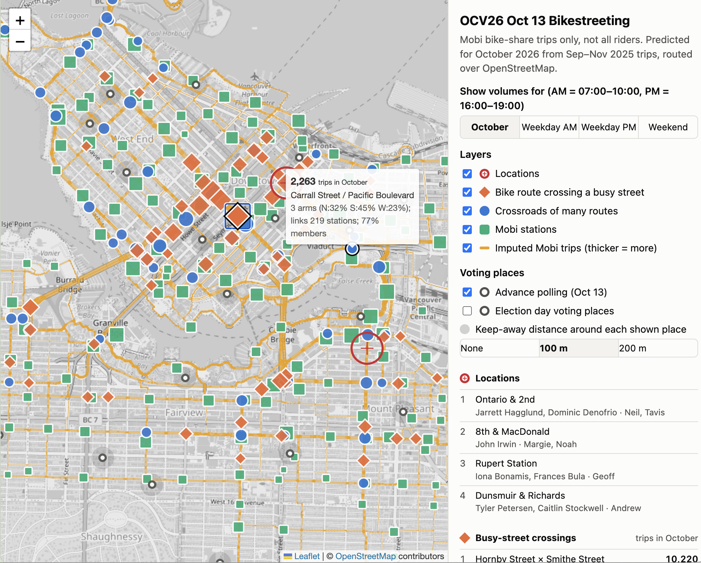

# OCV26 bike mainstreeting

This repo builds the map shown above. 

### 👉 [Try it!](https://neilk.github.io/mobi-density)

I hacked this together in a day or two, to help plan an outreach to bicyclists during the 
2026 Vancouver municipal elections. We called it "bikestreeting".

## What's "bikestreeting"?

"Mainstreeting" is going to a public place to interact with voters.

"Bikestreeting" is that, but on bike lanes. The question is... where to do it?

* We want to catch a lot of riders
* It helps if they are stopped or not moving quickly
* And, not within 100m of a polling place

One of the campaign directors asked for a data-driven approach. I may have overdelivered.

## What I did

### Map

The map and the routing is based on OpenStreetMap.

### Bike usage estimation

#### The City of Vancouver

As far as I can tell they don't publish any good bike data on their data portal.
It's not even clear what data they have.

#### Mobi

Using a personal Google Account, I downloaded data from Mobi for relevant months. Thanks
to the city partnership, the data is free to use. Just a bunch of CSVs showing 
every single ride in the city.

Mobi tracks when and where a bike was taken from its dock, and the same data for the return. We don't actually
know what route they took, but we can guess by doing the routing ourselves. 

Add up all the trips and make a big map of segments. Thicker = more rides.

Forecast October trips by looking at the same season a year earlier.

#### Intersections 

Figure out where heavily-used bike lanes intersect, and/or intersect major roadways. These
are prime targets for bikestreeting.

#### Polling places

In October 2026, the day we did this coincided with an advance polling day. So we had to keep
our distance (100m) from polling places.

Plot all polling places and draw circles around them. We had to eliminate one location because
we saw it was too close!

### Results already??

The result is an interactive map, `analysis/output/map.html` (built by the steps under
"Nerd stuff" below; it is not committed), which also carries the chosen
locations and their teams, the advance and election-day polling places with
100 m / 200 m keep-away circles. Mobi riders are a small sample of everyone
cycling, so treat the numbers as a guide to where cyclists go rather than as
crowd sizes.

## Nerd stuff

`data/original_data/` holds the Mobi monthly exports and station feeds that
everything is built from; `analysis/` holds the scripts, plain Python with no
third-party packages. Nothing generated is committed, including the map itself,
so after cloning you have to run the pipeline once before there is a map to
open or host.

[`analysis/README.md`](analysis/README.md) has the build instructions and
describes each file; the note beside it covers re-downloading the Mobi data.

### Publishing the map

The built map is served by GitHub Pages at
<https://neilk.github.io/mobi-density/>. `./publish.sh` copies
`analysis/output/map.html` to `index.html` on the `gh-pages` branch and pushes
it; that branch holds nothing but the page, so run the script again whenever
the map is rebuilt.
