# Corridor routing: where a Mobi rider could have been

Status: built. The sampler is `corridors.py`, `flood_demo.py` illustrates it
(`output/flood_demo.html`), and `flows.py` with `build_flow_map.py` produce the
monthly flow map (`output/flow_map.html`). The October forecast pipeline in
`routes.py` still routes each pair along its single cheapest path.

## The problem with the current routing

`routes.py` draws every trip between two stations along the single cheapest
route between them, and drops every trip that starts and ends at the same
station. Two things go wrong:

- **Round trips vanish.** They are 13% of all trips (15% of casual trips, 4% of
  member trips in the city, 8% of member trips at UBC), and they are
  concentrated at a few stations: the Stanley Park Information Booth alone has
  12,000 of them, with a tightly clustered odometer reading of about 9.6 km,
  which is one lap of the seawall. None of that riding appears on the map.
- **One-way trips are drawn too confidently.** A rider who took a detour, or
  simply preferred a parallel street, is drawn on the cheapest route anyway.

The fix is to spread each trip over the set of routes the rider could plausibly
have taken, rather than one route or none.

## What the data gives us

The monthly Mobi exports carry two columns the current pipeline ignores:
`Covered distance (m)` (the bike's odometer) and `Stopover duration (sec.)`.
The cleaned trip table keeps the odometer as `distance_m`.

The odometer, not the clock, is the right budget for "how far could they have
gone":

| | |
|---|---|
| Trips with an odometer reading | 95% |
| Median riding speed (distance over duration minus stopovers) | 12.3 km/h |
| 10th to 90th percentile riding speed | 6.7 to 17.7 km/h |
| Round trips with a zero reading (bike docked straight back) | 30% |

A time budget at an assumed 15 km/h would overestimate most riders' reach, and
would flood the zero-distance round trips across half a neighbourhood. The
odometer says exactly how far they went. `prep.py` already drops the
zero-distance trips.

## The method

Everything below works on the existing street graph from `routes.py`. Each
directed edge carries two numbers: its **length in metres**, and its
**perceived cost**, which is length times the existing way factor (a cycleway
feels 25% shorter, a primary road nearly twice as long, with discounts for
painted lanes and signed routes; `street-costs.md` has the full table and a
worked neighbourhood). Metres decide what is *feasible*; cost decides what is
*likely*.

### 1. Distance tables, one set per station, cached

For each station's street node, run Dijkstra's algorithm outward over the whole
graph and keep the result as a table: node → metres from the station. Run it
again on the reversed graph for node → metres *to* the station. Both are capped
at the longest odometer distance of interest (about 25 km), so they stop early.
A third table, perceived cost outward, is used only for round trips.

These are not paths. They are lookup tables, computed once per station
(roughly 250 stations, a few minutes in total) and stored on disk keyed on the
OSM file's hash.

### 2. The corridor, which is the prune

For a trip from A to B with odometer distance D, an edge from u to v is in the
corridor if

    metres_from_A[u] + length(u→v) + metres_to_B[v] <= D × (1 + slack)

That single addition asks "is there *any* route that uses this edge and still
fits the odometer?" An edge heading away from B fails because the distance back
is too large to recover. A dead-end street the rider has no reason to enter
fails the same way. What survives is a lens between A and B whose width
depends only on how much slack the odometer leaves. For a member's 930 m hop
with a 911 m direct route, the lens is one street wide with small alternatives
at each end. For a tourist's 9.6 km lap it covers Stanley Park and most of the
downtown peninsula.

The corridor becomes a small subgraph: typically a few hundred edges for a
short hop, 16,000 for the Stanley Park lap.

### 3. Shaking: drawing plausible routes from the corridor

We draw K routes (say 30) per trip group. For each draw:

1. Every OSM way in the corridor gets a random multiplier on its perceived
   cost, log-normal with scale σ. The multiplier is **per way, not per edge**,
   so a whole street comes out consistently cheaper or dearer in that draw.
   Per-edge noise would produce zig-zags between parallel streets.
2. Find the single cheapest route from A to B over the corridor under those
   shaken costs. It is a genuine shortest path, just for a rider who happened
   to find Burrard a little nicer than average that day.
3. Keep it if its physical length is between 85% of D and D plus slack.
   Otherwise discard and redraw. The odometer is a measurement, not just a
   ceiling: a route much shorter than D is as wrong as one longer.

**When shaking cannot fill the odometer.** Twelve shakes without a fit mean
the odometer is saying something the shake cannot: a third of one-way trips
run more than 20% past the direct distance and one in ten more than double
it, while for others every cheap street is longer than the odometer allows.
When the direct distance itself fits the fill window, the remaining draws are
the physically shortest route: the bike route overshoots, so the rider took
the main road. Otherwise the trip is a *detour*, A → t → B through one
waypoint drawn the way round-trip waypoints are (section 5): from the nodes
where the two shortest legs add up to a little under the odometer, weighted
by pleasantness and, for errands, by shops; the two legs are shaken shortest
paths with the second paying the re-use penalty on the first's streets. Only
trips whose odometer is shorter than any street path stay unrouted.

Each kept route is something a real rider might pick, never a random walk.
That is what makes this immune to the obvious trap: a dense residential grid
has astronomically more distinct walks through it than a single seawall path,
so any method that counts walks lets the grid win on sheer numbers.

### 4. Scoring

Each kept route gets the trip group's forecast weight divided by K, added to
every edge it uses, directionally. The output has the same shape as the
current path list (weight, node sequence, way sequence), so the crossing and
crossroads analysis consumes it unchanged apart from volumes becoming decimals.

A street that every route must use (the only way out of a cul-de-sac) gets the
whole trip. Four approaches to a destination share one trip between them. Side
streets that only win under a lucky shake get small decimals, not zero.

### 5. Round trips: three legs through two waypoints

There is no "toward B" for a trip that ends where it started, so round trips
are built as A → t1 → t2 → A, each leg a shaken shortest path over the
round-trip corridor (the same inequality with B = A).

Two waypoints, not one. With a single turnaround the way back is always the
shortcut, and no loop can ever come out. With two waypoints each about a third
of the way round, the legs chain into a loop.

Waypoints are drawn at random with weights that prefer:

- the right distance: about D/3 from the previous point, and about D/3 back to
  A for the second one;
- a pleasant ride there: the *average* cost per metre of the cheapest route to
  the point, below 1 along bikeways. It must be an average, not a total: a
  total rewards sheer distance, and an early version sent every tourist 6 km
  downtown because the long ride there had accumulated the most "niceness".
  How decisive it is depends on the purpose: for a ride taken for its own
  sake it dominates (the seawall is the point), for an errand it is mild, so
  the destination decides and the route merely gets there cheaply. With one
  scale for both, every errand from 10th & Cambie ended up on the 10th Avenue
  bikeway heading for the hospital, and none went north to Broadway.

Candidates are thinned to the best node per 200 m grid cell before drawing, so
downtown's thousands of intersections do not outvote the seawall by count.
Later legs pay a penalty (×3) for re-using earlier legs' ways, so a loop closes
rather than retracing where a loop exists. The whole route must still use at
least 85% of the odometer distance.

### 6. Station context: what the ride is for

Street cost alone cannot say where a round trip *goes*. Nor does rider type,
on its own: a member who docks at the Stanley Park Information Booth is on a
park ride just as surely as a tourist is, because nobody lives in Stanley
Park and getting there was already an intentional journey. What tells the
purpose of a round trip is **where it starts**.

A second OSM extract (`data/osm/download_attractors.sh`, read by
`attractors.py`) supplies the waterfront, parks and beaches, residential land
use, and shops and amenities. For each station:

- **scenic**: the share of a 300 m disc that is waterfront, park or beach;
- **home**: the share of a 400 m disc that is residential land use, i.e.
  whether anyone lives there;
- **leisure share** = scenic × (1 − 0.7 × home), nudged ±0.15 by rider type
  where there is housing at all, clamped to 0..1.

Each round-trip sample first draws its purpose with that probability:

- **Leisure ride.** Every edge within 150 m of the water costs 0.35 of its
  usual cost, on every leg and inside the waypoint pleasantness. Waterfront
  only: a park polygon also contains the paths beside the Stanley Park
  Causeway, which are nobody's idea of scenic.
- **Errand.** Waypoints are up to eleven times more attractive where shops
  and amenities cluster. The score is logarithmic in the count within 150 m,
  saturating at forty, so a clinic cluster of ten reads about 0.65 and
  Cambie Village reads 1.

Station contexts the model computes, for a feel:

| Station | scenic | home | leisure share, casual / member |
|---|---|---|---|
| Stanley Park Information Booth | 0.98 | 0.00 | 0.98 / 0.98 |
| Stanley Park Aquarium | 1.00 | 0.00 | 1.00 / 1.00 |
| Chilco & Robson | 0.63 | 0.22 | 0.69 / 0.42 |
| Jericho Beach | 0.65 | 0.24 | 0.70 / 0.41 |
| Kitsilano Beach Park | 0.55 | 0.51 | 0.50 / 0.20 |
| Bute & Barclay | 0.14 | 0.51 | 0.24 / 0.00 |
| 10th & Cambie | 0.00 | 0.31 | 0.15 / 0.00 |

Where the samples go, after the fixes below:

| Station, rider, odometer | Samples | Where they go |
|---|---|---|
| Stanley Park booth, casual or member, 9.6 km | 60 | 37 lap the west side of the park, 26 ride Coal Harbour or English Bay |
| Chilco & Robson, casual, 3.0 km | 30 | 22 into the park, 5 into the West End |
| Chilco & Robson, member, 3.0 km | 30 | 17 into the park, 11 into the West End |
| Jericho Beach, casual, 3.8 km | 30 | 19 west along the beach, 4 into the neighbourhood |
| Jericho Beach, member, 3.8 km | 30 | 15 along the beach, 6 into the neighbourhood |

The Stanley Park lap started at 1 in 30. Most of the gain came not from any
of this but from a map bug it exposed, described next. The remaining
Coal Harbour and English Bay rides are the open question: the odometer
histogram at the booth says the lap is nearer to all of them than to 60%.

### Knobs

| Knob | Demo value | What it does |
|---|---|---|
| σ (shake) | 0.35 | 0 reproduces today's single shortest path; larger spreads routes across the corridor |
| scenic way factor | 0.35 | leisure rides: cost multiplier on waterfront edges |
| commercial bonus | 10 | errands: extra waypoint weight where shops saturate |
| station radii | 300 m, 400 m | how far round a station counts as scenic, and as lived-in |
| home cut | 0.7 | how much a fully residential neighbourhood lowers the leisure share |
| rider nudge | ±0.15 | casual up, member down, only where anyone lives |
| slack | 5% | how far past the odometer a route may run |
| minimum fill | 85% | how far short of the odometer a route may fall |
| K | 30 | routes per trip group |
| direct shakes | 12 | one-way trips: failed shakes before the group becomes a plain route or a detour |
| candidate window | 3 sd | waypoints further than this from their target spacing are not scored |
| reuse penalty | ×3 | round trips: cost multiplier on streets already ridden |
| waypoint spread | 12% of D | round trips: how loosely waypoints sit around D/3 |
| pleasantness scale | 0.05 leisure, 0.3 errand | round trips: how much a lower average cost per metre to a waypoint raises its weight |
| cell size | 200 m | round trips: thinning grid for waypoint candidates |

σ is the one that matters. One check is available without guessing: the
spread of odometer-versus-direct distance on one-way trips says how much
riders actually detour. Which parallel streets carry the bikes would need an
independent source of street-level counts, which this project does not have.

### Cost and caching

Trips are grouped by origin, destination, rider type and odometer bin, and
each group is sampled once and multiplied by its forecast weight. The forecast
only draws on three months:

| | |
|---|---|
| Trips in the forecast months | 256,000 |
| Distinct groups at 250 m bins | 89,000 |
| Draws per group | 30 |

About 2.7 million small Dijkstra runs over corridors of a few hundred edges:
under an hour single-threaded, and easy to split across cores. Each group's
sampled routes are cached keyed on origin, destination, rider type, distance
bin, K, σ and a seed derived from the key, so reruns with the same settings
cost nothing, a σ change invalidates exactly what it should, and results are
reproducible and independent of processing order. Round trips cost more per
sample (two extra bounded Dijkstra runs from the first waypoint) but are 13% of
trips.

### Street costs: what changed while building the demo

Two trial renders of the Stanley Park lap went wrong in ways that were about
the street costs, not the sampler, and both fixes apply to the existing
pipeline too:

- **Unpaved ways** (gravel, dirt, grass and so on) now cost the same as a
  plain path, not a bikeway. **Any unpaved way at 3% grade or steeper costs
  four times that.** This is what keeps Mobi riders off the Avison Trail
  switchbacks from the seawall up to Prospect Point. Grade comes from the
  open AWS terrain tiles (`data/elevation/download.sh`, read by
  `elevation.py`); without them routing warns and ignores slope. Flat parks
  are unaffected: in the corridor of a 3.8 km round trip from Jericho Beach,
  2,473 unpaved edges keep the plain-path cost and only 128, on the bluff up
  to 4th Avenue, get the slope penalty. All 30 sampled round trips from there
  enter Jericho park and a third ride west along the beach.
- **Walk-your-bike (dismount) stretches** cost ten times their length instead
  of three, and footways tagged dismount are now routable at all. They were
  not, and that severed the seawall: the 75 m walk-your-bike stretch under the
  Lions Gate Bridge is a dismount footway, so from the Information Booth the
  only way to the west side of the park was up Avison Trail. This one gap is
  why the lap never came out, whatever the sampler did.
- **An explicit exclusion list** (`OBSCURE_WAYS` in `routes.py`) for ways that
  exist but riders do not know or use, each with a comment. First entry: the
  dirt underpass at the Lions Gate abutment that joins the two causeway bike
  paths. OSM cannot carry this kind of local knowledge, and the list is where
  it goes.

### Known limitations

- Round trips are a cruder model than one-way trips. Three legs produce loops
  and out-and-backs but not, say, a figure of eight.
- The station-context knobs were set by hand against three stations. A
  proper check would compare the sampled round-trip flows against independent
  street-level cycling counts across the whole city.
- Residential land use in OSM is patchy in places (the West End reads low),
  so "home" under-counts some dense neighbourhoods. Building footprints would
  be a better source at the cost of a much larger extract.
- The corridor is a set of edges, not paths, so a shaken shortest path can
  still exceed the odometer. That is why samples are checked and redrawn.

## Worked examples

`flood_demo.py` draws three map panels per example: two single shakes, then
all thirty draws at once. In a single-shake panel every corridor street is
coloured by its shake multiplier (blue cheaper than usual, red dearer) and
labelled with it when zoomed in; hover a street for its base cost. The thick
black line is the route picked under that shake, the dashed line the unshaken
shortest path.

The all-draws panel is what the trip actually contributes to the map: thirty
sampled routes, each drawn at 1/30 opacity over the corridor in faint blue. A
street every draw uses comes out solid, one used by a single draw is barely
there, and the shading in between is the fractional ridership the trip gives
that street. That is the "ten routes, each worth a tenth" idea made visible.

To regenerate: from `analysis/`, after `prep.py` and with the three extracts
in place (`data/osm/download.sh`, `data/osm/download_attractors.sh`,
`data/elevation/download.sh`), `uv run python flood_demo.py`, then `./serve.sh`
from the repo root and open
<http://localhost:8000/analysis/output/flood_demo.html>. It takes about half a
minute. The images below are screenshots of that page's panels, saved in
`img/`.

### A short hop: Bute & Barclay → Haro & Denman, member, odometer 930 m

The direct route is 911 m, so the corridor is a sliver: Haro Street end to
end, with a choice of how to leave Bute & Barclay (Bute, or Stovold Lane then
Jervis) and how to arrive at Denman. Thirty-two streets are in play.

Shake 1 picks Stovold Lane → Jervis → Haro → Cardero Bikeway → Haro; shake 2
picks Bute → Haro → Cardero Bikeway → Haro. Both are 911 to 912 m. Over many
shakes the Haro Street blocks in the middle collect the whole trip, and the
alternative first and last blocks share it.

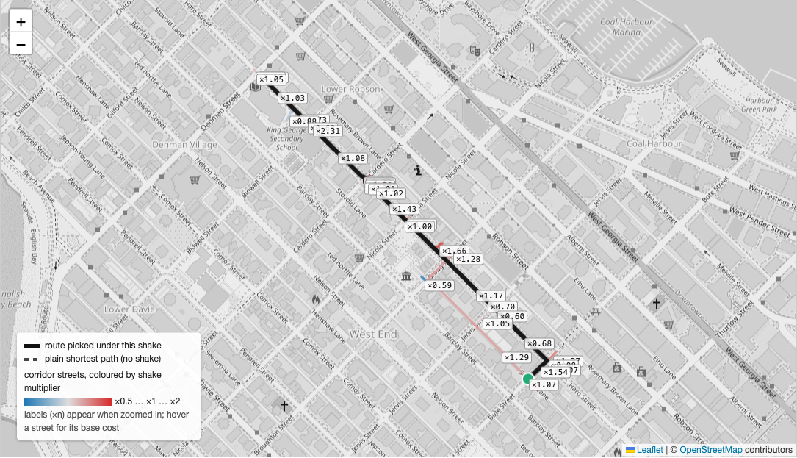

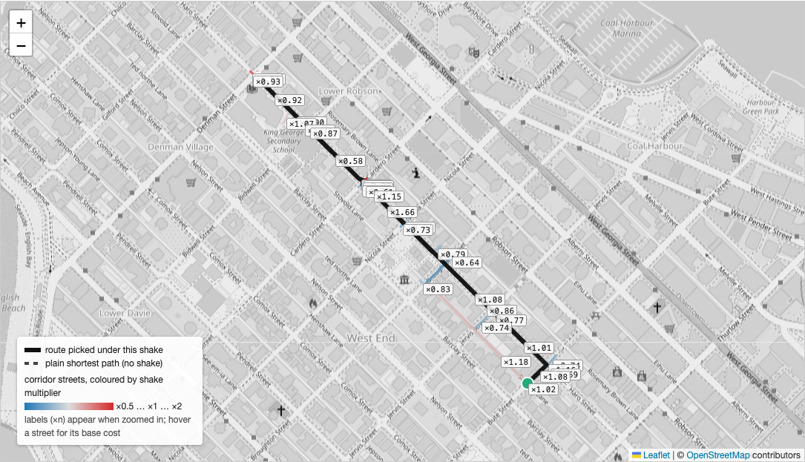

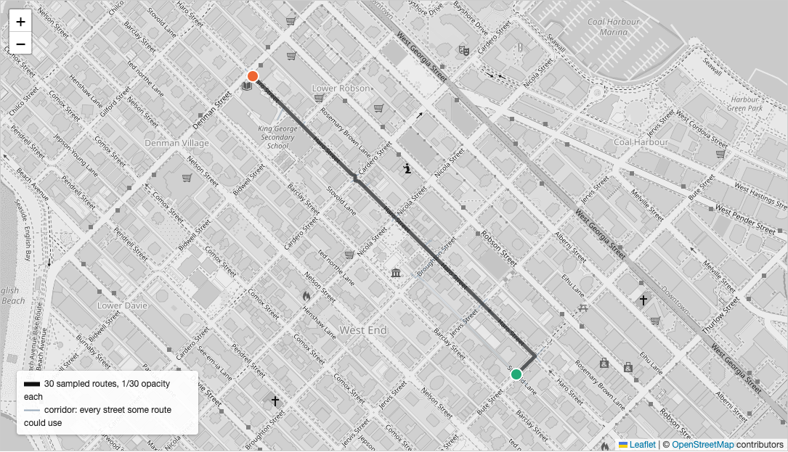

### A round trip: Stanley Park Information Booth and back, casual rider, odometer 9,570 m

The corridor covers the park and the downtown peninsula (16,000 edges). The
tight odometer readings at this station (12,000 round trips, three quarters
of them between 9.0 and 9.9 km) say nearly everyone laps the seawall. The
station's leisure share is 0.98, so every sample is a leisure ride whoever
the rider is. About six samples in ten lap the park; the rest ride the Coal
Harbour waterfront toward Canada Place or English Bay and back, which is a
scenic ride too, just not the one the odometer histogram points at. The two
panels are chosen to show one of each.

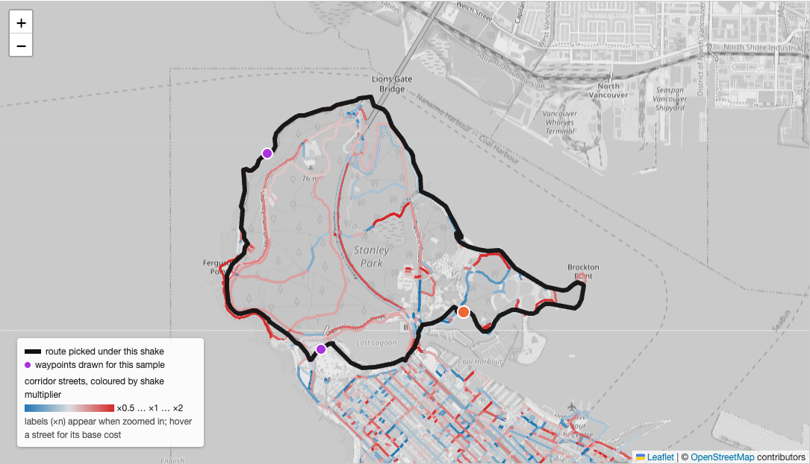

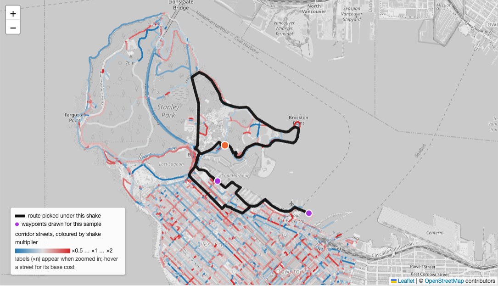

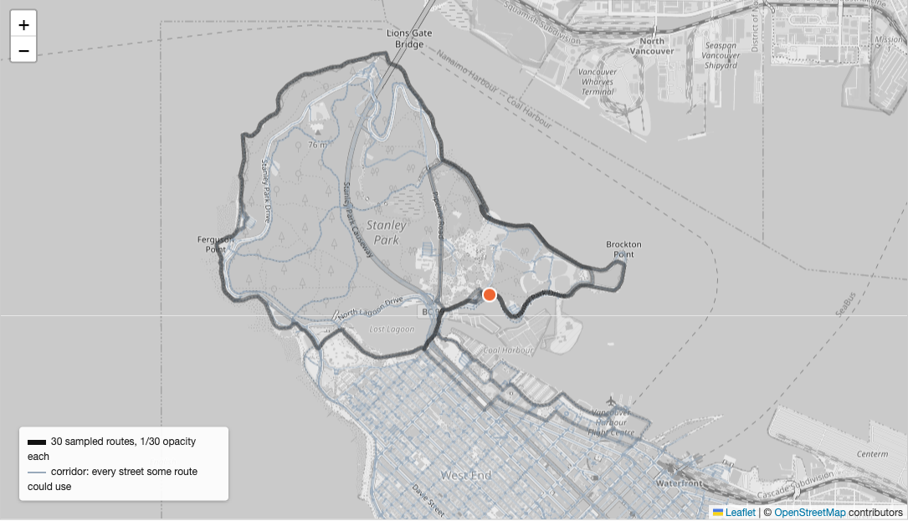

### Three more round-trip stations

Each at that station's median round-trip odometer for the rider type shown:
two shakes, then all thirty draws.

**Chilco & Robson, casual, 9,660 m.** The median casual round trip here is
the same length as at the Information Booth: tourists start the seawall lap
from the park entrance too. The station's leisure share is 0.69, since there
is some housing within 400 m. Over 30 samples, 10 lap the west side of the
park, 17 enter the park at all, 12 cross to Kitsilano or False Creek along
the seaside route, and 9 are errands. The panels show one lap and one
Kitsilano ride.

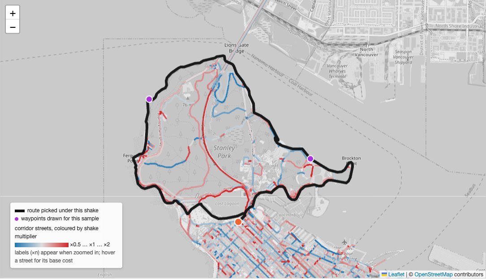

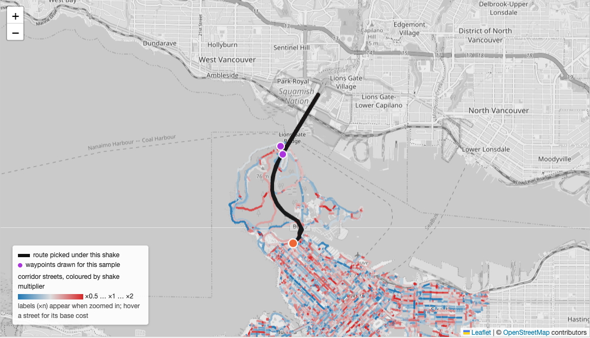

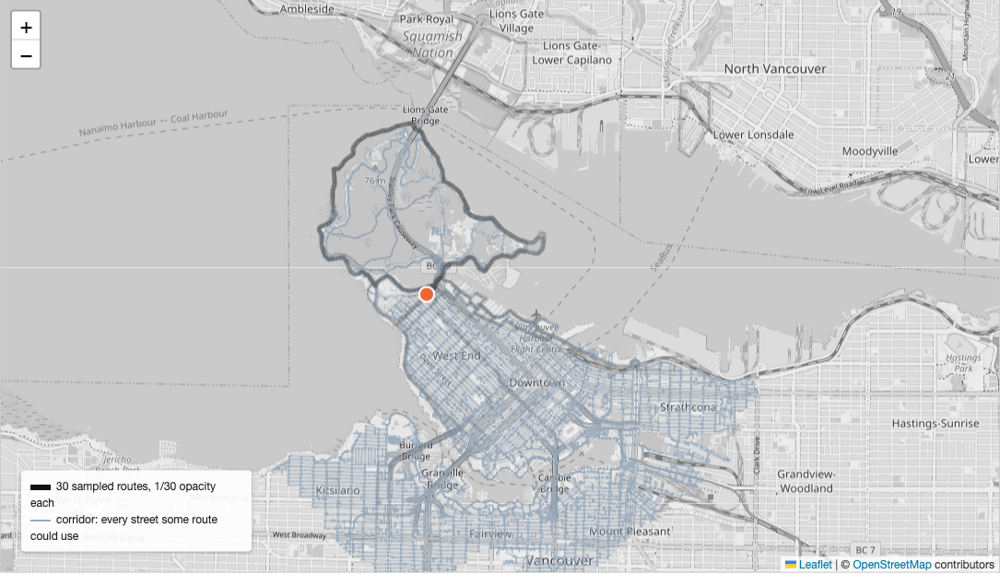

**Chilco & Robson, member, 3,700 m.** Leisure share 0.42. Samples split
between the Coal Harbour seawall and Lost Lagoon on the leisure side and
Denman and Robson shops on the errand side.

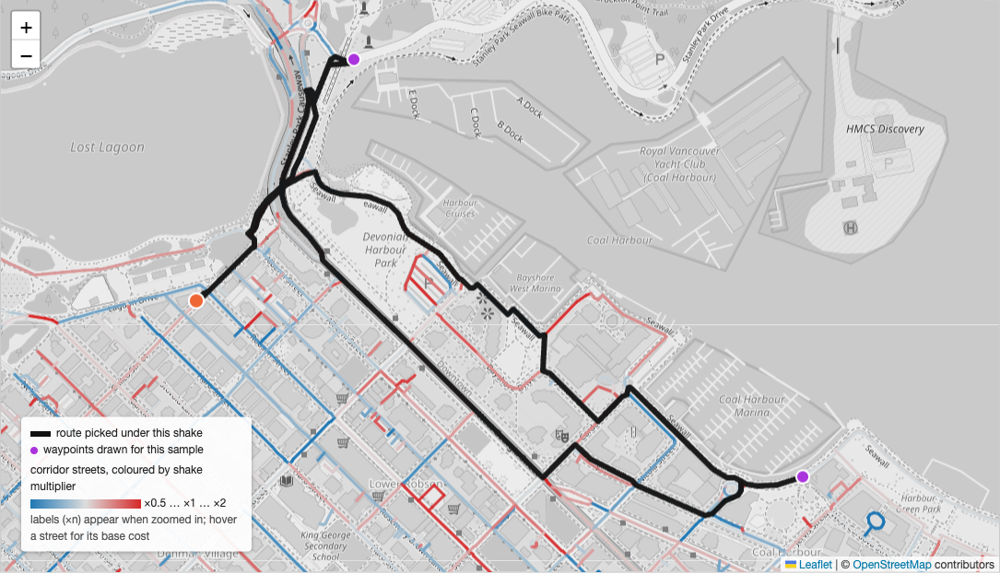

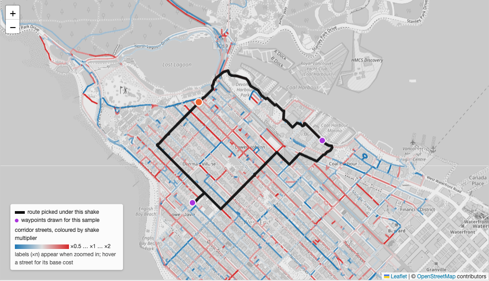

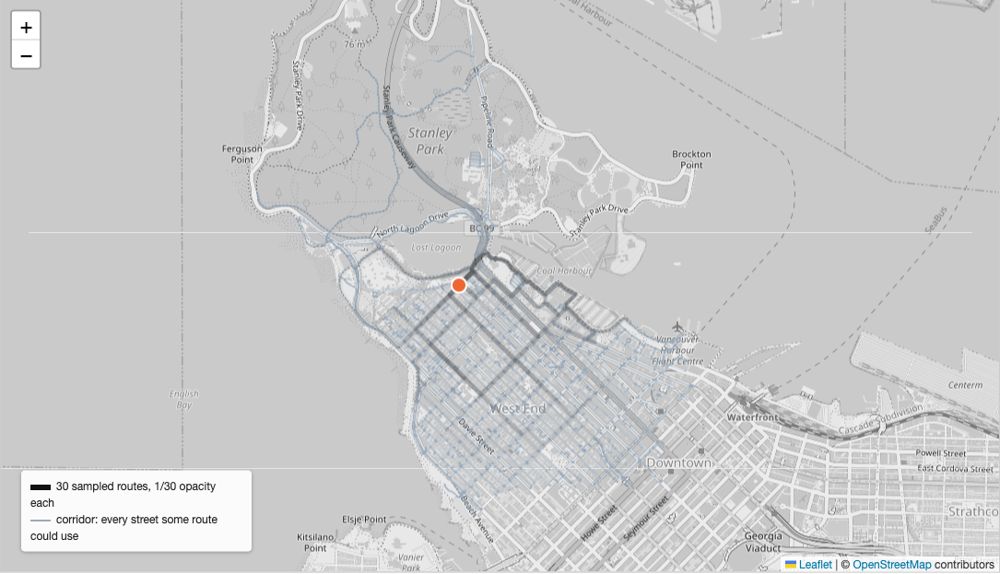

**Jericho Beach, casual, 4,050 m.** Leisure share 0.70. Most samples ride
west along the beach to Locarno or Spanish Banks and come back through the
park; the errand minority heads up to 4th Avenue.

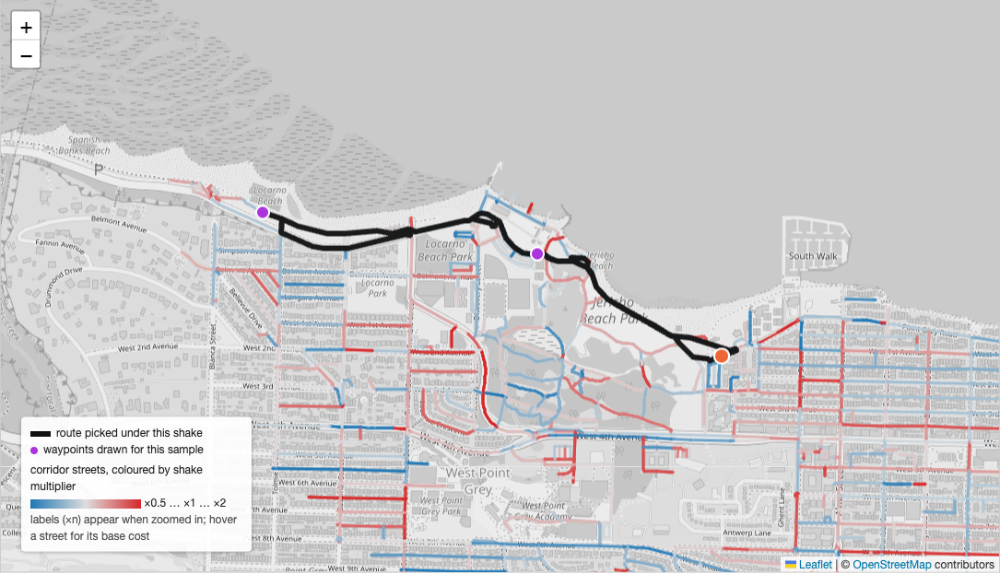

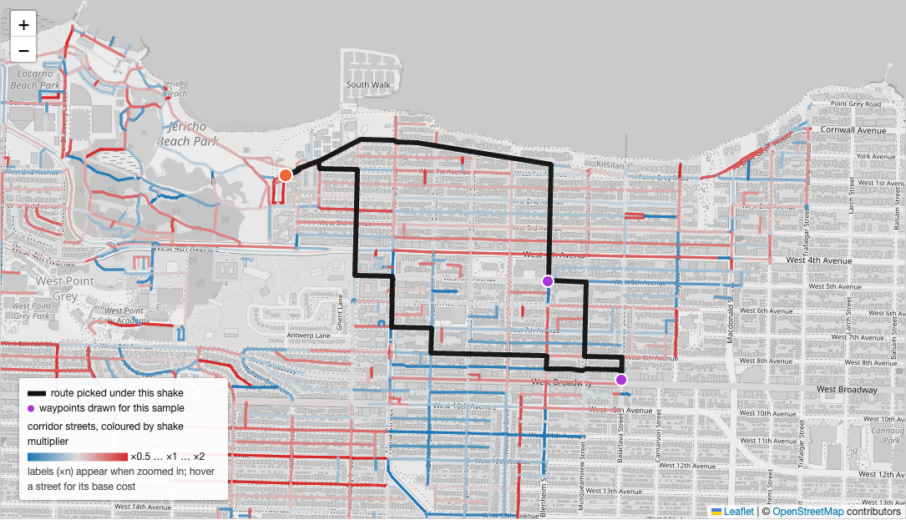

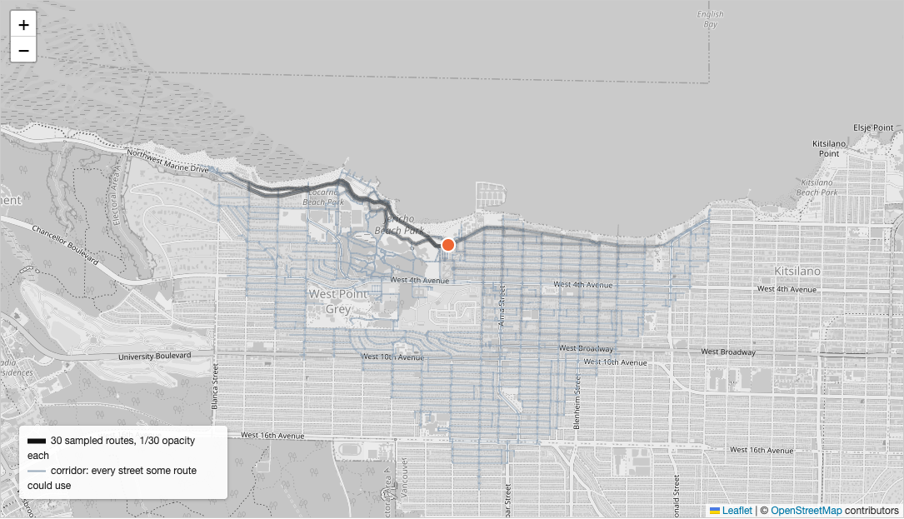

**10th & Cambie, member, 1,900 m.** No water or park within 300 m, so the
leisure share is 0 and every sample is an errand. Of 30: 15 go west along the
10th Avenue bikeway toward the hospital district, 14 north to Broadway or
beyond, 3 east past Main, 1 south down Cambie.

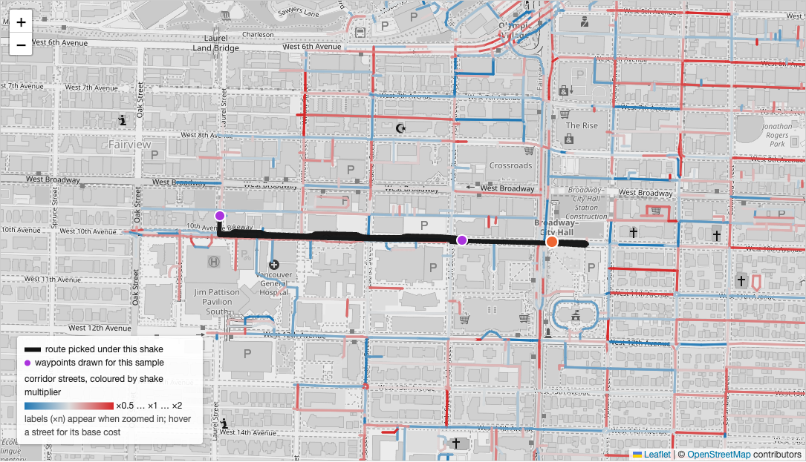

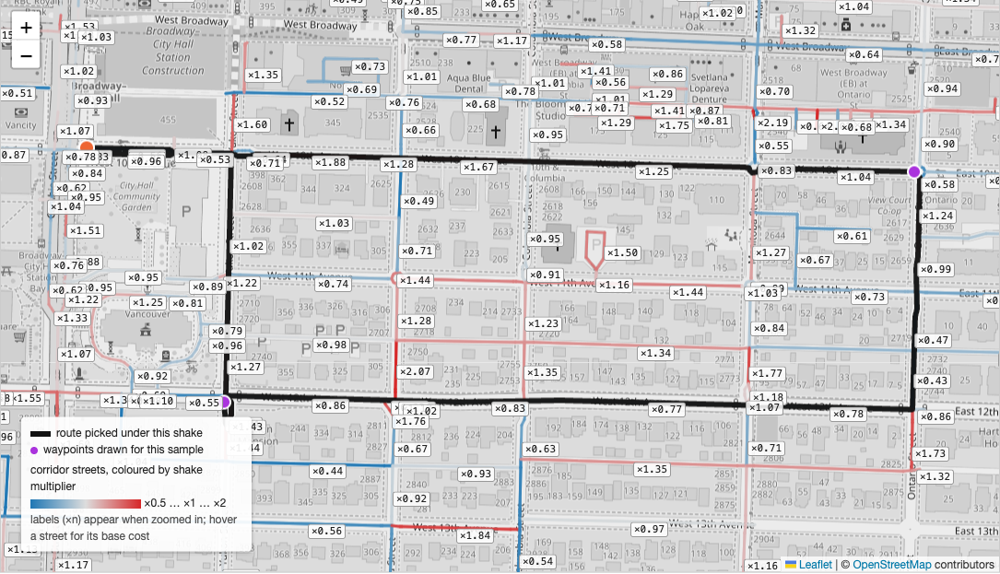

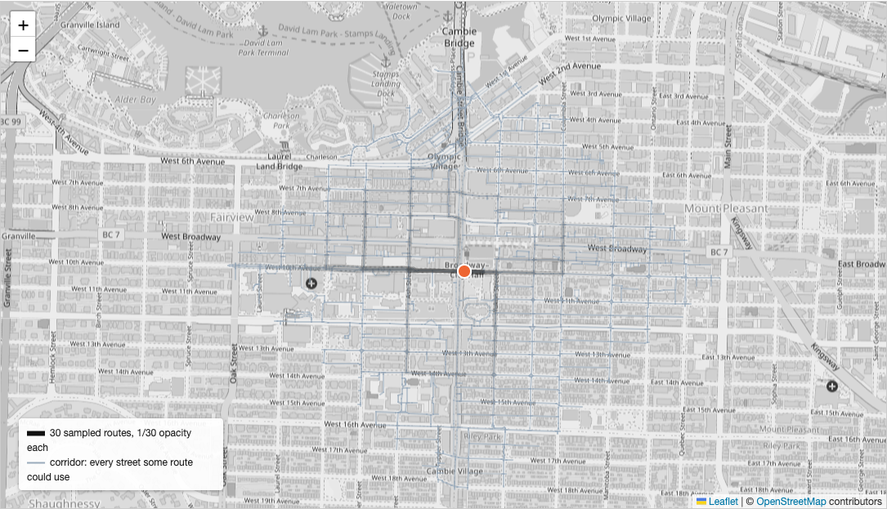

## Wiring it in: the monthly flow map

The first product of the corridor routing is a map of one historical month:
every street segment shaded by how many Mobi riders passed along it, from
every trip that month, round trips included. No forecasting. The existing
October map and its crossing tables are untouched.

**Inputs.** One month of `data/trips_clean.csv` (default: the latest month
present, currently July 2026 with 136,590 trips), the OSM extract, the
attractors extract and the terrain tiles. Trips with no odometer reading are
skipped; `prep.py` already drops them.

**Grouping.** Trips are grouped by origin station, destination station, rider
type and 250 m odometer bin. Each group is sampled once: up to 30 routes,
fewer for small groups (never fewer than 8), at the group's median odometer
distance. Each route carries the group's trip count divided by the number of
draws. Round-trip groups use the station-context purpose draw.

**Slices.** Every trip belongs to one of 24 slices: weekday or weekend
(`common.day_type`), one of the six three-hour blocks in `common.BLOCKS` by
departure hour, and member or casual. A group's trips are spread over the
slices they fall in, so each street segment ends up with 24 counts. The page
sums whichever combination the viewer picks: rider (all, member, casual), day
(all, weekday, weekend) and block (all or one of six).

**Segments.** Loads are summed per undirected edge of the street graph,
both directions together. Each output segment carries its two endpoints,
street name, street kind (`rider_way_kind` in `routes.py`) and the 24 counts.

**Outputs.** `output/flows_<month>.json` from `flows.py`; `output/flow_map.html`
from `build_flow_map.py`. Sampled routes are cached in
`output/cache/flows.sqlite` keyed on the group and the sampler settings, so a
rerun with the same settings costs nothing and a second month only samples
its new groups.

**Rendering.** One ink colour on the grey basemap. Opacity follows the square
root of load relative to the busiest segment in the chosen slice, floored so
quiet streets stay faintly visible; width grows a little with load. A linear
scale leaves only the seawall; a log scale flattens the busy streets
together. Hovering a segment shows the street, its kind and riders in the
chosen slice. Stations are small, light markers. A legend states the month,
the slice and the scale.

**Code layout.** The sampler moves out of `flood_demo.py` into
`corridors.py`, which both the demo and `flows.py` import. `flows.py` runs
origin stations in parallel across cores with a forked pool, since the graph
is read-only once built. A worker takes its origin's groups in destination
order and keeps only its newest eight destination-side tables, so its memory
stays flat; waypoint candidates are scored once per group and reused across
draws.

**Performance budget.** July 2026 is 63,000 groups over 266 origins. A median
origin of 220 groups samples in about a minute on one core, so the month takes
on the order of half an hour, and a rerun is free. Workers default to one per
core but no more than one per 3 GiB of memory, since each grows to about a
gigabyte; `--workers N` overrides. The route cache is committed after every
origin, so an interrupted run resumes where it stopped.
