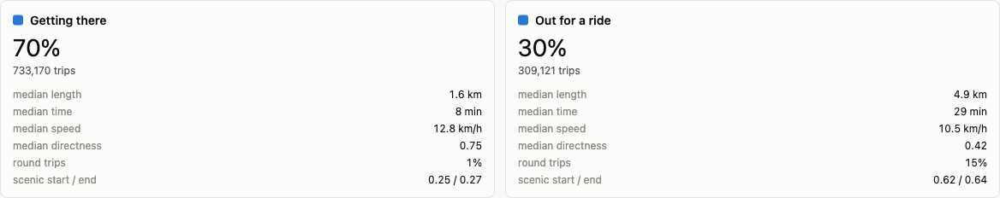
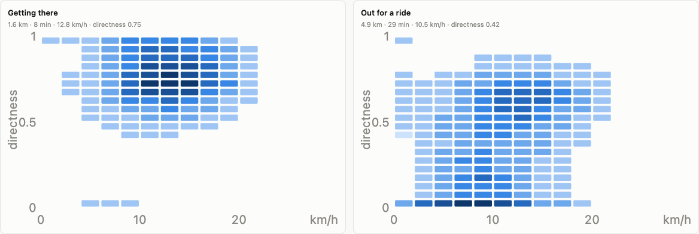
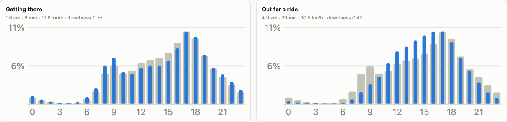
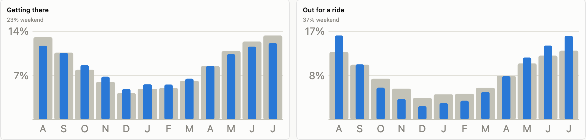
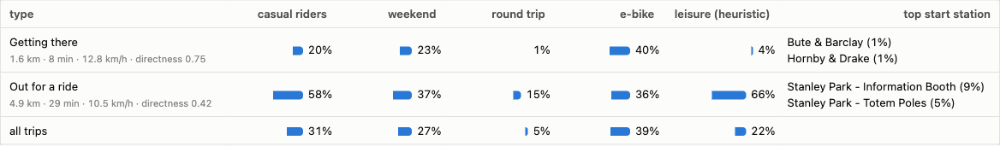

# Do Mobi rides separate into types?

A year of Mobi trips (August 2025 to July 2026, 1,042,291 with usable
telemetry) clustered by how the ride looked: how direct it was, how long and
how fast, how scenic its two stations are, and when it left. Rider type,
e-bike and month were kept out of the clustering so they could be used to
check the result.

`trip_types.py` builds the features and runs k-means; `build_trip_types.py`
renders `output/trip_types.html`, which the screenshots below are taken from.

## The short answer

Yes, but along one axis. Rides split cleanly into **getting there** (70%) and
**out for a ride** (30%). Any further split runs along the clock (weekday
morning, weekday evening, weekend) or along trip length, not along a new
kind of behaviour. The silhouette score, which measures how much closer trips
sit to their own cluster than to the next one, is highest at two clusters
(0.24) and drops after that; all the scores are low, so the two types are
the ends of a continuum rather than two islands.

| | Getting there | Out for a ride | All trips |
|---|---|---|---|
| trips | 733,170 (70%) | 309,121 (30%) | 1,042,291 |
| median length | 1.6 km | 4.9 km | |
| median time | 8 min | 29 min | |
| median speed | 12.8 km/h | 10.5 km/h | |
| median directness | 0.75 | 0.42 | |
| round trips | 1% | 15% | 5% |
| scenic score, start / end | 0.25 / 0.27 | 0.62 / 0.64 | |
| weekend | 23% | 37% | 27% |
| casual riders | 20% | 58% | 31% |
| e-bike | 40% | 36% | 39% |
| leisure by the explorer heuristic | 4% | 66% | 22% |
| top start stations | Bute & Barclay, Hornby & Drake, Bute & Davie (1% each) | Stanley Park Information Booth (9%), Totem Poles (5%), Third Beach (4%) | |

Directness is the straight line between the two stations divided by the
odometer: 1.0 is a beeline, 0 is a round trip. The scenic score is the share
of a 300 m disc around the station that is waterfront, park or beach
(`attractors.py`), so Stanley Park, Granville Island and the seawall stations
score 0.9 to 1.0 and downtown office stations near 0. The leisure heuristic
is the one on mobi-transit-explorer.adnanreza.com: round trip +3, waterfront
end +2, over 40 minutes +2 (over 20 +1), weekend +1, midday +1, detour above
1.8x the straight line +1; four points is leisure.

## What separates them

**Directness and speed do most of the work.** Getting-there trips sit in a
tight blob at directness 0.6 to 0.95 and 10 to 16 km/h. Out-for-a-ride
trips spread across directness 0.2 to 0.8 at every speed below 14 km/h, with
a separate band of round trips along the bottom.

**Time of day.** Getting there has the commuter's two peaks, 9:00 and 17:00
to 18:00. Out for a ride is one afternoon hump from noon to 18:00, and
almost nobody goes out for a ride before 9:00.

**Season.** Both types shrink in winter, but out-for-a-ride rides shrink six
times over (15.8% of its trips in August, 2.5% in December) where getting
there shrinks two and a half times (11.8% to 4.7%). Months were not a
clustering input; the summer lean is a property of how the rides look.

**Tourist appeal.** Out-for-a-ride trips start and end at stations with a
mean scenic score of 0.62, against 0.25 for getting there, and one in five of
them starts at one of the three busiest Stanley Park stations.

## Who rides which

- **Rider type is a weak proxy for trip purpose.** Casual riders are the
  majority of out-for-a-ride trips (58%), but members still make 42% of them,
  about 130,000 rides. Casual riders also make 147,000 getting-there trips, a
  fifth of that type. The lgeo.co analysis uses Stanley Park stations as the
  recreational proxy and the explorer uses a points heuristic; both work for
  the same reason this clustering does, which is that the ride itself tells
  you more than who paid for it.
- **E-bikes belong to neither type.** 40% of getting-there trips and 36% of
  out-for-a-ride trips are electric. E-bikes are not a leisure toy or a
  commuter tool; they are both.
- **The explorer heuristic agrees with the clustering.** 66% of
  out-for-a-ride trips score as leisure against 4% of getting-there trips.
  The third of out-for-a-ride trips that the heuristic calls utility
  (105,005 trips) are the middle of the continuum: weekday rides (80%) of
  3.7 km and 18 minutes at 12.6 km/h with directness 0.60, most of them
  (78%) touching the waterfront, so they collect the waterfront points but
  miss the round-trip, weekend and 40-minute ones. Longer and more scenic
  than a commute, more purposeful than a loop.

## Finer splits

Forcing more clusters shows what the next distinctions are
(`uv run python trip_types.py --k 4`):

| k=4 | share | looks like |
|---|---|---|
| weekday afternoon and evening, getting there | 36% | 1.9 km, 9 min, directness 0.74, peak 17:00, 0% weekend |
| weekday morning, getting there | 25% | 1.7 km, 8 min, directness 0.74, peak 9:00, 0% weekend |
| weekend, getting there | 21% | 1.9 km, 10 min, directness 0.73, 100% weekend, 30% casual |
| out for a ride | 18% | 6.7 km, 45 min, 9.4 km/h, directness 0.19, 23% round trips, scenic 0.70, 71% casual, 84% leisure by heuristic |

At k=5 a short-hop cluster appears (19% of trips: 1.0 km, 5 min, directness
0.79, none of them leisure by the heuristic) and a mid-length weekday
afternoon cluster (23%: 3.1 km, 15 min, directness 0.68, scenic 0.38, 29%
casual) that sits between the two main types; the out-for-a-ride core
tightens to 14% of trips at 7.9 km, 51 minutes and 92% leisure by the
heuristic.

So the utility side of the network divides by when, not by how: the ride
looks the same at 9:00, at 17:00 and on Saturday. The leisure side does not
divide at all; it just gets purer as k grows. The weekend flag is a binary
feature, which gives it a lot of leverage in k-means once the main split is
made, so the k=4 and k=5 clusters should be read as "what else varies" rather
than as types in their own right.

## Data and method

- `prep.py` now carries the source file's exact `Duration (sec.)` as
  `duration_s`. The cleaned table's timestamps are rounded to the hour, so
  speed and directness need the source column, which agrees with the
  timestamps to within the hour for 99.5% of trips.
- 37,529 trips (3.5%) were excluded as bad telemetry: 33,272 with a duration
  under 60 seconds (most of them with kilometres on the odometer), 2,446
  station-to-station trips with no odometer, 1,791 faster than 30 km/h and 20
  longer than 40 km. Slow trips were kept: 2 km/h with a long duration is a
  bike locked up mid-ride, which is a real leisure signal.
- Features, each z-scored: log odometer, log duration, directness, scenic
  score of the start and of the end station, sine and cosine of the departure
  hour, weekend flag. k-means++ with three restarts on a seeded sample of
  100,000 trips; every usable trip is then assigned to its nearest centroid.
  k was chosen by silhouette over k = 2..8, each fitted on a 20,000-trip
  sample and scored on 4,000 of them: 0.24, 0.20, 0.21, 0.18, 0.18, 0.18,
  0.17.
- Directness uses the straight line, not a routed distance, so a trip
  around False Creek or Stanley Park looks less direct than it was. This
  inflates "wandering" for some station pairs; the lgeo.co analysis routed
  with OpenTripPlanner and found non-park routes at about 1.0x the routed
  distance and Stanley Park routes at 1.22x, so the straight-line bias is
  mostly on the leisure side where it does not change the answer.
- The scenic score counts every park polygon, so a station beside a
  neighbourhood park gets some tourist appeal it does not deserve. The
  waterfront and the big parks dominate the score where it matters.
